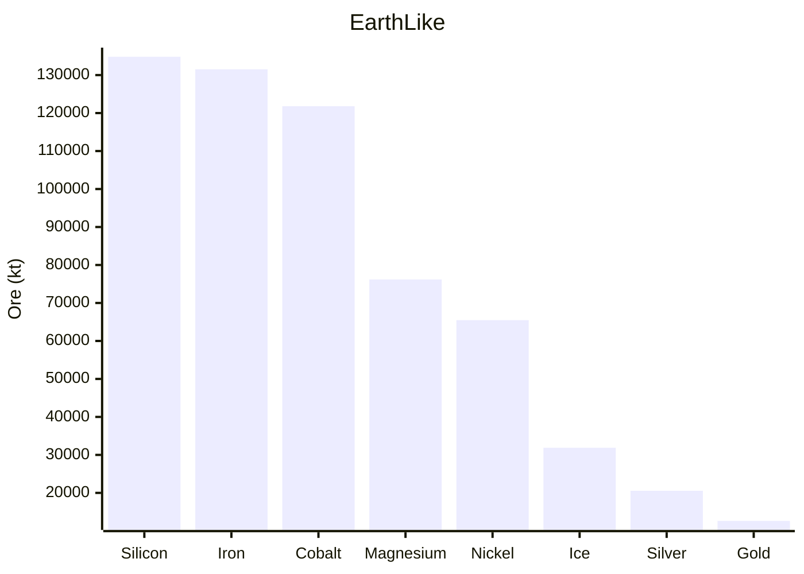
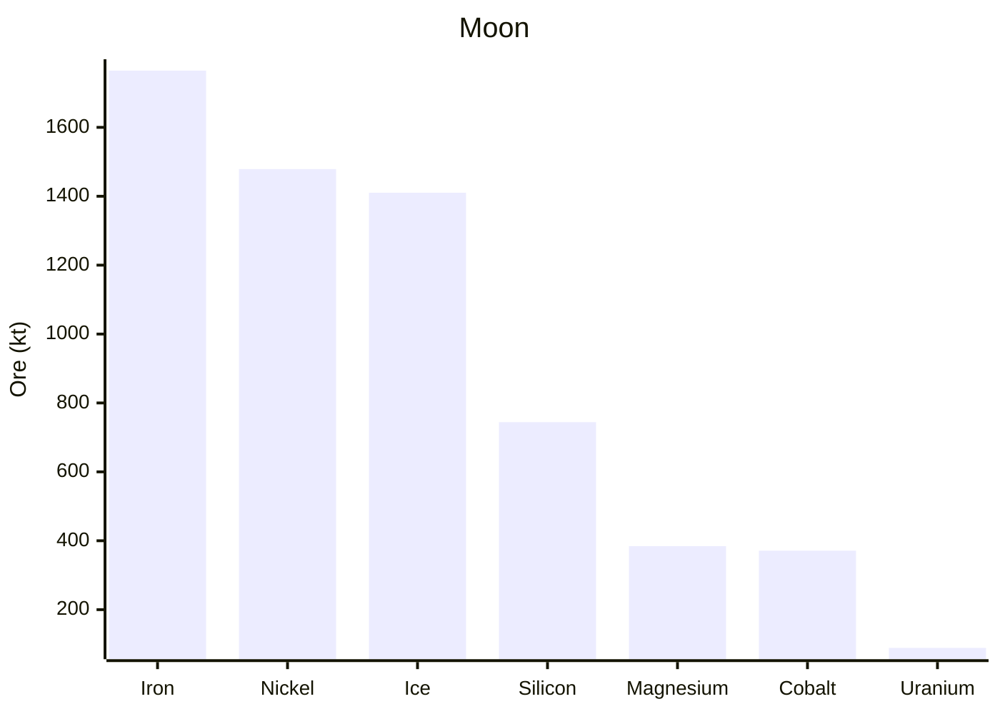
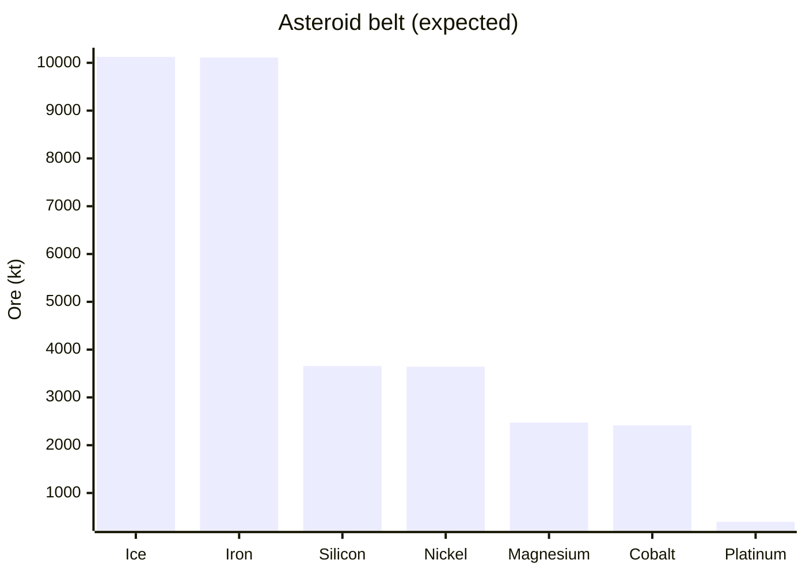
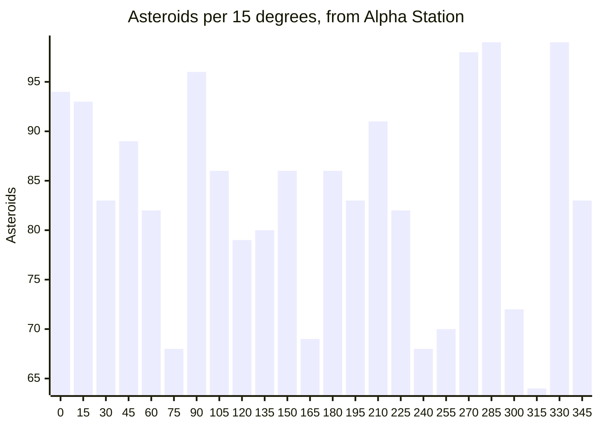

# Ore statistics: Octahedron

Generated by `ore_stats.py` from the world in `server/` (seed 42) and the
OctahedronOres mod built with the same seed. Amounts are approximate: ore in
tonnes as a ship drill mines it (HarvestRatioMultiplier 1), before
refining. Ore rock is the volume of the ore-bearing voxels.

- EarthLike and the Moon are counted from the mod's ore maps: each ore pixel is
  a column of ore as wide as the pixel on the surface (radius 60,000 m and
  9,500 m) and as deep as its ore mapping. A deposit is a connected patch of
  ore pixels on one cube face (one crossing a face edge counts twice), counted
  once for every ore in it.
- The asteroid belt is an expectation, not a count: the game rolls each
  asteroid's ores from its seed with its own random generator. It applies
  generator 4's rules (MyCompositeShapes) to the belt's 2000 procedural asteroids
  (1006 of 256 m, 807 of 512 m, 187 of 1024 m), with DepositsCountCoefficient 2 and
  DepositSizeDenominator 30. A deposit is a sphere, and
  part of it may stick out of the rock, so the belt's amounts are upper bounds.
- Not counted: the stone around the deposits, the 4 placed ice asteroids
  (whole `SuperRock_001` shapes of ice, 1024 m storages) and about 20 procedural asteroids
  the generator makes whole ice.

## Overview

| Ore | EarthLike (t) | Moon (t) | Asteroid belt (t) |
|---|---:|---:|---:|
| Iron | 132,000,000 | 1,760,000 | 10,100,000 |
| Silicon | 135,000,000 | 744,000 | 3,660,000 |
| Cobalt | 122,000,000 | 371,000 | 2,420,000 |
| Magnesium | 76,200,000 | 384,000 | 2,470,000 |
| Nickel | 65,500,000 | 1,480,000 | 3,640,000 |
| Ice | 31,900,000 | 1,410,000 | 10,100,000 |
| Silver | 20,600,000 | - | - |
| Gold | 12,600,000 | - | - |
| Platinum | - | - | 397,000 |
| Uranium | - | 88,800 | - |

## EarthLike

| Ore | Deposits | Ore rock (m³) | Ore (t) |
|---|---:|---:|---:|
| Silicon | 17,000 | 1,850,000,000 | 135,000,000 |
| Iron | 10,000 | 1,080,000,000 | 132,000,000 |
| Cobalt | 13,000 | 1,670,000,000 | 122,000,000 |
| Magnesium | 17,000 | 1,040,000,000 | 76,200,000 |
| Nickel | 10,800 | 897,000,000 | 65,500,000 |
| Ice | 10,800 | 262,000,000 | 31,900,000 |
| Silver | 9,240 | 845,000,000 | 20,600,000 |
| Gold | 10,800 | 519,000,000 | 12,600,000 |

## Moon

| Ore | Deposits | Ore rock (m³) | Ore (t) |
|---|---:|---:|---:|
| Iron | 1,150 | 14,500,000 | 1,760,000 |
| Nickel | 1,920 | 20,300,000 | 1,480,000 |
| Ice | 1,150 | 11,600,000 | 1,410,000 |
| Silicon | 769 | 10,200,000 | 744,000 |
| Magnesium | 768 | 5,270,000 | 384,000 |
| Cobalt | 1,150 | 5,090,000 | 371,000 |
| Uranium | 768 | 12,200,000 | 88,800 |

## Asteroid belt

| Ore | Deposits | Ore rock (m³) | Ore (t) |
|---|---:|---:|---:|
| Ice | 3,300 | 83,300,000 | 10,100,000 |
| Iron | 3,290 | 83,100,000 | 10,100,000 |
| Silicon | 1,980 | 50,100,000 | 3,660,000 |
| Nickel | 1,980 | 49,900,000 | 3,640,000 |
| Magnesium | 1,340 | 33,900,000 | 2,470,000 |
| Cobalt | 1,310 | 33,100,000 | 2,420,000 |
| Platinum | 647 | 16,300,000 | 397,000 |

## Asteroids around the ring

The procedural asteroids per 15° of the ring, counted from Alpha Station
counterclockwise as seen from above EarthLike's magnetic north pole. The ring's
plane is fitted to the asteroids; it is tilted 25° from the equator.
Storage sizes: the rock inside is smaller. "Here" lists the equatorial stations
and the 4 placed ice asteroids by their direction from EarthLike's center.

| Segment | Asteroids | 256 m | 512 m | 1024 m | Here |
|---|---:|---:|---:|---:|---|
| 0°-15° | 94 | 43 | 42 | 9 | Alpha Station |
| 15°-30° | 93 | 42 | 39 | 12 |  |
| 30°-45° | 83 | 34 | 39 | 10 | Ice-4 |
| 45°-60° | 89 | 52 | 30 | 7 |  |
| 60°-75° | 82 | 45 | 29 | 8 |  |
| 75°-90° | 68 | 33 | 25 | 10 | Delta Station |
| 90°-105° | 96 | 40 | 48 | 8 |  |
| 105°-120° | 86 | 51 | 30 | 5 |  |
| 120°-135° | 79 | 39 | 34 | 6 |  |
| 135°-150° | 80 | 37 | 34 | 9 | Ice-3 |
| 150°-165° | 86 | 48 | 27 | 11 |  |
| 165°-180° | 69 | 37 | 23 | 9 |  |
| 180°-195° | 86 | 43 | 37 | 6 | Gamma Station |
| 195°-210° | 83 | 51 | 24 | 8 |  |
| 210°-225° | 91 | 39 | 43 | 9 | Ice-2 |
| 225°-240° | 82 | 46 | 28 | 8 |  |
| 240°-255° | 68 | 36 | 27 | 5 |  |
| 255°-270° | 70 | 42 | 24 | 4 | Beta Station |
| 270°-285° | 98 | 51 | 39 | 8 |  |
| 285°-300° | 99 | 43 | 50 | 6 |  |
| 300°-315° | 72 | 36 | 31 | 5 |  |
| 315°-330° | 64 | 27 | 30 | 7 | Ice-1 |
| 330°-345° | 99 | 45 | 38 | 16 |  |
| 345°-360° | 83 | 46 | 36 | 1 |  |

